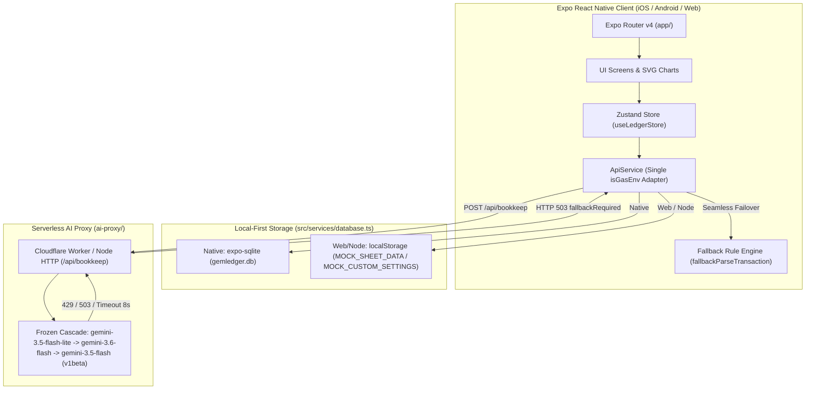

# 📊 GemLedger-26 Mobile ── Local-First 跨平台多幣別 AI 智慧記帳系統

[](https://opensource.org/licenses/MIT)
[](https://expo.dev/)
[](https://reactnative.dev/)
[](https://docs.expo.dev/versions/latest/sdk/sqlite/)
[](https://workers.cloudflare.com/)
[](https://ai.google.dev/)

---

## 一、 專案背景與架構演進

**GemLedger-26** 原為基於 Google Apps Script + Google Sheets 的無伺服器記帳系統（原始碼已完整歸檔於 [`legacy-gas/`](./legacy-gas/)）。v2.0 正式升級為 **Local-First 原生行動優先架構（React Native + Expo SDK 52 + Expo Router + `expo-sqlite` + Serverless Gemini AI Proxy）**，一套程式碼同時支援 **iOS、Android 與 Web**：

1. **資料主權完全本地化 (Local-First)**：所有交易明細、自訂帳戶/分類與匯率快取皆優先儲存於裝置本機的 SQLite 資料庫（Web/Node 環境自動切換為 `localStorage`），零延遲讀寫、完全離線可用，支援一鍵匯出 CSV / JSON 備份。
2. **極低輸入摩擦力**：提供「⚡ 極速記帳（內建四則運算計算機鍵盤與連續記帳）」與「✨ AI 智慧記帳（自然語言口語 + 收據拍照多模態解析）」雙模式 Bottom Sheet。
3. **API 金鑰零外洩的邊緣 AI 代理**：透過獨立的 Serverless Proxy (`ai-proxy/`) 保管 `GEMINI_API_KEY`，並內建三層模型級聯容錯與離線規則備援引擎 (`fallbackParseTransaction`)，即使斷網或雲端 `503` 仍能精準記帳。

---

## 二、 核心功能模組

### 1. 總覽首頁與跨幣別淨資產看板 ([`app/(tabs)/index.tsx`](./app/(tabs)/index.tsx))
- **SVG 漸層淨資產總覽卡 ([`NetWorthHeroCard`](./src/components/NetWorthHeroCard.tsx))**：採用 `tabular-nums` 等寬數字排版，整合 11 國幣別一鍵切換 (`TWD`, `USD`, `JPY`, `EUR`, `KRW`, `GBP`, `CNY`, `HKD`, `SGD`, `THB`, `AUD`)、即時匯率參考條與手動更新匯率按鈕，以及實質收入／純支出對照。
- **多維度即時篩選與日期分組明細**：支援關鍵字搜尋，以及月份、帳戶、分類、幣別横向快速篩選標籤；交易列表依日期分組並即時計算當日收入／支出小計，點擊卡片即可編輯或刪除。

### 2. 帳戶錢包視圖 ([`app/(tabs)/wallet.tsx`](./app/(tabs)/wallet.tsx))
- **堆疊式電子錢包卡片**：以 Apple Wallet / Revolut 風格呈現各帳戶（如 `現金`、`LINE Pay`、`永豐銀行`、`台新Richart` 等）折算為基準幣別之餘額、總資產佔比進度條、交易筆數與原幣別分佈明細；點擊帳戶卡可直接跳轉首頁並套用該帳戶篩選。

### 3. 互動式財務分析儀表板 ([`app/(tabs)/analytics.tsx`](./app/(tabs)/analytics.tsx))
- **精準財務口徑 (`computeKPIStats`)**：計算「實質總收入」、「本期純支出」與淨現金流時，自動排除 `初始資產`、`內部轉帳` 與 `代墊款`，並即時計算 **恩格爾係數（伙食餐飲比例）**。
- **SVG 互動式圖表**：
  - [`DonutChart`](./src/components/DonutChart.tsx)：分類支出甜甜圈圖，支援點擊扇區高亮並聯動下方分類排行清單。
  - [`TrendBarChart`](./src/components/TrendBarChart.tsx)：收支趨勢分組長條圖，支援「按日 / 按月」切換與單期數值檢視。

### 4. 極速記帳與 Gemini AI 智慧記帳 ([`app/quick-add.tsx`](./app/quick-add.tsx))
- **⚡ 極速記帳模式**：整合 [`CalculatorKeypad`](./src/components/CalculatorKeypad.tsx)（支援 `120+45` 行內算式求值與 `expo-haptics` 觸覺回饋）、正負收支切換、11 幣別即時折算預覽、帳戶/分類快速標籤與「連續記帳」開關；同時支援從交易卡點擊進入編輯模式 (`editId`)。
- **✨ AI 智慧記帳模式**：支援口語自然語言輸入與 `expo-image-picker` 相機／相簿收據上傳（Base64），透過 [`AIDraftCard`](./src/components/AIDraftCard.tsx) 渲染多筆解析草稿，支援寫入前展開「微調」、防連點安全鎖 (`isSubmitting`)、單筆確認及「一鍵全部寫入」，並標示使用的模型或 `503 離線規則引擎` 狀態。

### 5. 系統設定與資料可攜性 ([`app/(tabs)/settings.tsx`](./app/(tabs)/settings.tsx))
- **主題切換**：支援 `淺色` / `深色` / `跟隨系統`（透過 [`ThemeContext`](./src/theme/ThemeContext.tsx) 動態切換）。
- **帳戶與分類級聯管理**：自由新增或刪除自訂帳戶與分類；刪除前顯示關聯交易筆數警告，確認後透過 `deleteAccountCascade` / `deleteCategoryCascade` 同步清理關聯紀錄。
- **AI Proxy 與測試開關**：可設定遠端 `aiProxyUrl` 及切換 `simulate503` 以驗證離線規則引擎備援。
- **資料匯出與重置**：支援 CSV / JSON 匯出（Web 下載或行動端系統 `Share`）及重置種子資料。

---

## 三、 系統架構與目錄結構



### 目錄與關鍵檔案

```text
gemledger-26/
├── app/                          # Expo Router 頁面與導航
│   ├── _layout.tsx               # Root Stack (SafeAreaProvider + ThemeProvider + Store 初始化)
│   ├── quick-add.tsx             # 雙模式極速 / AI 記帳 Bottom Sheet Modal
│   └── (tabs)/
│       ├── _layout.tsx           # 4 分頁浮動玻璃底部導航列 + 中央 + FAB
│       ├── index.tsx             # 首頁總覽與交易明細
│       ├── analytics.tsx         # 收支分析儀表板
│       ├── wallet.tsx            # 多幣別帳戶錢包
│       └── settings.tsx          # 系統設定、AI Proxy 設定與 CSV/JSON 匯出
├── src/
│   ├── types/ledger.ts           # 核心 TypeScript 型別與 11 幣別定義
│   ├── theme/                    # 主題色彩系統與分類/帳戶 Metadata
│   ├── utils/                    # 幣別換算格式化 (currency.ts) 與 KPI/圖表運算 (analytics.ts)
│   ├── services/
│   │   ├── database.ts           # expo-sqlite (Native) + localStorage (Web/Node) 雙引擎與自動種子資料
│   │   ├── fallbackParser.ts     # 503 離線抗干擾規則解析引擎
│   │   └── apiService.ts         # 唯一環境偵測點與雙環境適配器 (MODELS_CASCADE 凍結)
│   ├── store/useLedgerStore.ts   # Zustand 全域狀態管理 (嚴格經由 ApiService 讀寫)
│   └── components/               # DonutChart, TrendBarChart, NetWorthHeroCard, CalculatorKeypad, AIDraftCard 等
├── ai-proxy/                     # 獨立 Serverless Gemini AI Proxy (Cloudflare Workers + Node)
│   ├── src/index.ts              # /health 與 /api/bookkeep 邊緣端點 (v1beta 模型級聯與重試)
│   ├── wrangler.toml             # Cloudflare Workers 部署設定
│   └── README.md                 # AI Proxy 詳細環境變數與部署說明
├── tests/ledger.test.ts          # 核心規則解析、匯率分析與 ApiService 級聯刪除單元測試
└── legacy-gas/                   # 歸檔之 Google Apps Script 舊版程式碼 (Code.gs, index.html, clasp 設定)
```

---

## 四、 工程規範與合規設計

1. **Adapter Pattern 隔離與雙環境同構** (`.agents/rules/coding-rules.md`)：
   - 所有 UI 畫面與 `useLedgerStore` 嚴格透過 `ApiService` 存取資料，完全不直接呼叫 `google.script.run` 或散落環境判斷。
   - `isGasEnv` 僅於 [`src/services/apiService.ts`](./src/services/apiService.ts) 內部評估一次；本地模式自動寫入真實種子資料實現零設定開箱即測。
2. **Gemini 模型級聯凍結 (`MODELS_CASCADE`)**：
   - 前端 [`src/services/apiService.ts`](./src/services/apiService.ts) 與後端 [`ai-proxy/src/index.ts`](./ai-proxy/src/index.ts) 皆嚴格鎖定 `['gemini-3.5-flash-lite', 'gemini-3.6-flash', 'gemini-3.5-flash']` 並呼叫 Gemini `v1beta` `generateContent`。
3. **結構化可觀測日誌**：
   - 所有服務、Store 與代理端點均注入 `[Module/Function Name] Action - Summary` 格式日誌，便於追蹤跨層資料流與錯誤排查。

---

## 五、 安裝、啟動與測試指南

### 1. 啟動行動端 / Web 應用程式

```bash
# 安裝根目錄相依套件
npm install

# 啟動 Expo 開發伺服器 (掃描 QR Code 於實體手機 Expo Go 預覽)
npm start

# 或直接啟動指定平台
npm run web       # Expo Web (Metro Bundler)
npm run ios       # iOS 模擬器
npm run android   # Android 模擬器
```

> **零設定離線體驗**：未設定 `aiProxyUrl` 時，系統會自動啟用內建種子資料 (`localStorage` / `expo-sqlite`) 與本地規則解析引擎 (`fallbackParseTransaction`)，無需任何外部 API Key 即可完整操作所有功能。

### 2. 啟動與部署 Serverless AI Proxy (`ai-proxy/`)

若需啟用雲端 Gemini 多模態文字與收據圖片辨識，請參考 [`ai-proxy/README.md`](./ai-proxy/README.md)：

```bash
cd ai-proxy
npm install

# 方式 A：本地 Node HTTP 開發伺服器 (Port 8787)
GEMINI_API_KEY=your_gemini_api_key npm run dev

# 方式 B：本地 Cloudflare Workers 模擬執行
# 先於 ai-proxy/.dev.vars 寫入 GEMINI_API_KEY=your_gemini_api_key
npm run dev:worker

# 方式 C：部署至 Cloudflare Workers
npx wrangler secret put GEMINI_API_KEY
npm run deploy
```

啟動或部署完成後，於 App 的 **設定 → AI Proxy 端點** 填入 Proxy URL（例如 `http://localhost:8787` 或 `https://gemledger-ai-proxy.<subdomain>.workers.dev`）即可。

### 3. 型別檢查、單元測試與 Web 打包驗證

```bash
# 根目錄 TypeScript 型別檢查
npm run typecheck

# AI Proxy TypeScript 型別檢查
cd ai-proxy && npm run typecheck && cd ..

# 執行單元測試 (node:test via tsx)
npm test

# 驗證 Expo Web Metro 靜態打包
npx expo export --platform web
```

---

## 六、 舊版 GAS 歸檔說明

原 Google Apps Script + Google Sheets 版本之 `Code.gs`、`index.html`、`appsscript.json`、`.claspignore` 與 `.clasp.json.example` 已保留歸檔於 [`legacy-gas/`](./legacy-gas/)，作為歷史版本參考。

---

## 📄 開源授權 (License)

本專案基於 [MIT License](https://opensource.org/licenses/MIT) 授權開源。
