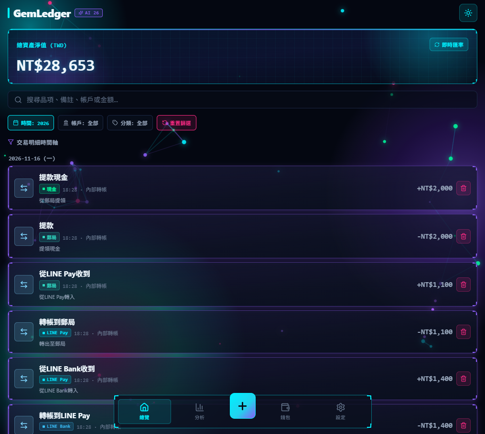
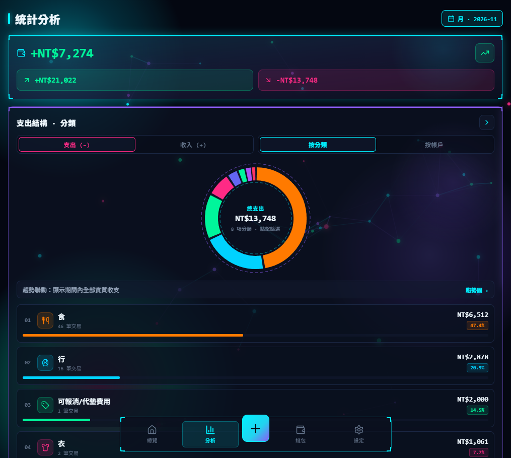
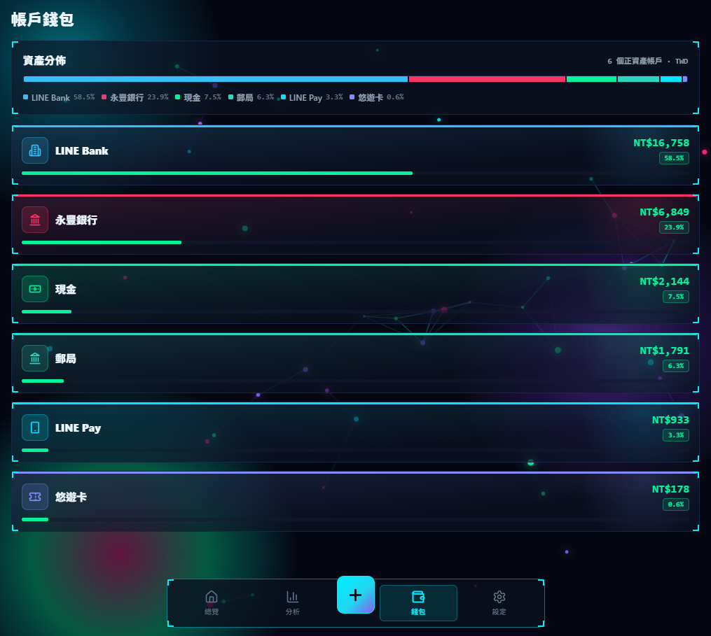
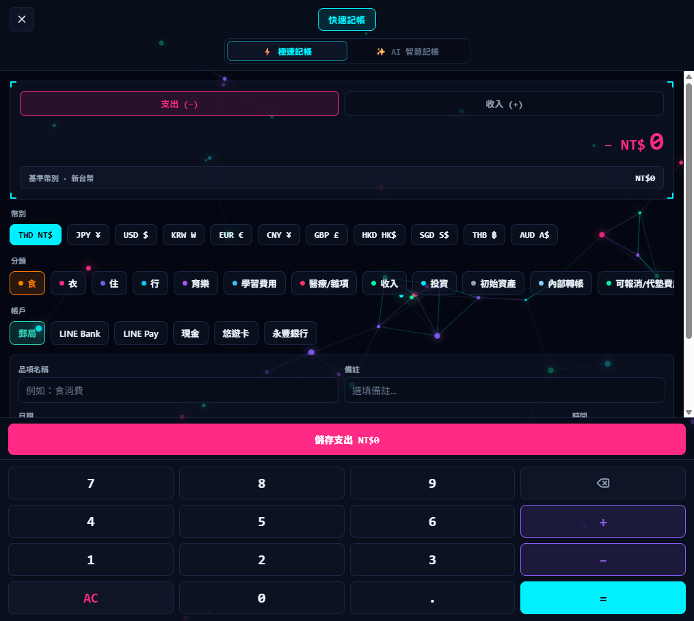
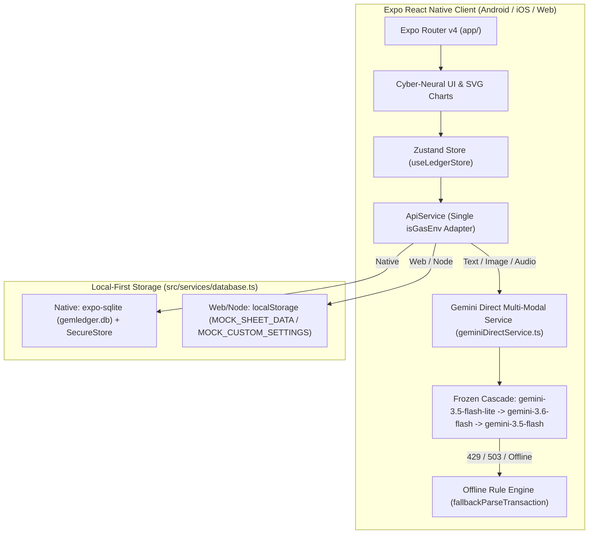

# 📊 GemLedger-26 Mobile (v2.1.0) ── Local-First 跨平台多幣別 AI 智慧記帳系統

[](https://github.com/jaytsbo/gemledger-26-speach)
[](https://gemledger-26.pages.dev/)
[](https://opensource.org/licenses/MIT)
[](https://expo.dev/)
[](https://reactnative.dev/)
[](https://docs.expo.dev/versions/latest/sdk/sqlite/)
[](https://ai.google.dev/)

> 🌐 **線上網頁版即時體驗 (Live Web Demo)**：[**https://gemledger-26.pages.dev/**](https://gemledger-26.pages.dev/)

---

## 📱 應用程式畫面預覽 (App Screenshots)

### 1. 總覽首頁、財務統計分析與帳戶錢包

| 🏠 總覽首頁 (`Overview`) | 📈 統計分析 (`Analytics`) | 👛 帳戶錢包 (`Wallet`) |
| :---: | :---: | :---: |
|  |  |  |
| **跨幣別淨資產看板**、即時匯率同步、時間/帳戶/分類多重篩選與交易明細時間軸 | **SVG 甜甜圈結構圖 (`DonutChart`)**、收支趨勢圖、分類/帳戶維度切換與排行占比 | **資產分佈色條**、6+ 自訂帳戶圖示、折算基準幣別餘額與資產占比進度條 |

### 2. 極速記帳、AI 智慧記帳 (語音/拍照/文字) 與系統設定

| ⚡ 極速記帳 (`Manual Quick Add`) | ✨ AI 智慧記帳 (`Gemini AI Bookkeep`) | ⚙️ 系統設定 (`Settings`) |
| :---: | :---: | :---: |
|  |  |  |
| **內建四則運算計算機鍵盤**、11 國幣別即時換算預覽、成對內部轉帳與連續記帳 | **自然語言口語 / 語音錄音 / 收據拍照多模態解析**、待確認草稿微調與一鍵寫入 | **本位幣別與匯率設定**、帳戶/分類級聯管理、個人 Gemini 金鑰管理與 CSV 匯入/匯出 |

---

## 一、 專案背景與架構演進

**GemLedger-26** 原為基於 Google Apps Script + Google Sheets 的無伺服器記帳系統（原始碼已完整歸檔於 [`legacy-gas/`](./legacy-gas/)）。v2.1 全面升級為 **Local-First 原生行動優先架構（React Native 0.76 + Expo SDK 52 + Expo Router v4 + `expo-sqlite` + Gemini 3.5/3.6 Direct Multi-Modal Engine）**，一套程式碼同時支援 **Android APK、iOS 與 Web (Cloudflare Pages)**：

1. **資料主權完全本地化 (Local-First)**：所有交易明細、自訂帳戶/分類、匯率快取與 AI 對話草稿皆優先儲存於裝置本機的 SQLite 資料庫（Web/Node 環境自動切換為 `localStorage`），零延遲讀寫、完全離線可用，支援 CSV 智慧匯入與 CSV / JSON 一鍵備份匯出。
2. **Cyber-Neural 視覺設計與極低輸入摩擦力**：搭載動態神經網路粒子背景 (`CyberNeuralBackground`)、HUD 準星邊框 (`HudReticle`) 與物理彈簧按鈕 (`SpringPressable`)；提供「⚡ 極速記帳（四則運算計算機鍵盤 + 成對內部轉帳）」與「✨ AI 智慧記帳（文字 + 語音錄音直傳 + 收據拍照壓縮解析）」雙模式視窗。
3. **三層 Gemini 模型級聯與離線規則備援**：原生端透過 `expo-secure-store` 安全儲存使用者自訂 API Key，直連 Google Gemini `v1beta` 多模態端點（含智慧媒體壓縮與 Adaptive Thinking 降級），並內建三層模型級聯容錯 (`gemini-3.5-flash-lite` $\rightarrow$ `gemini-3.6-flash` $\rightarrow$ `gemini-3.5-flash`) 與離線規則備援引擎 (`fallbackParseTransaction`)，即使斷網或雲端 `503` 仍能精準記帳。

---

## 二、 核心功能模組

### 1. 總覽首頁與跨幣別淨資產看板 ([`app/(tabs)/index.tsx`](./app/(tabs)/index.tsx))
- **HUD 淨資產總覽卡 ([`NetWorthHeroCard`](./src/components/NetWorthHeroCard.tsx))**：採用 `tabular-nums` 等寬數字排版，整合 11 國幣別自動折算 (`TWD`, `USD`, `JPY`, `EUR`, `KRW`, `GBP`, `CNY`, `HKD`, `SGD`, `THB`, `AUD`) 與即時匯率更新按鈕。
- **多維度即時篩選與日期分組明細**：支援關鍵字即時搜尋，以及時間（近兩日 / 指定年份 / 月份 / 單日）、帳戶、分類快速篩選；交易列表依日期分組，點擊卡片即可進入編輯或刪除。

### 2. 帳戶錢包視圖 ([`app/(tabs)/wallet.tsx`](./app/(tabs)/wallet.tsx))
- **資產分佈橫條與自訂帳戶卡片**：頂部以多色比例條直觀呈現所有正資產帳戶的資金配置權重；下方列出各帳戶（如 `LINE Bank`、`永豐銀行`、`現金`、`郵局`、`LINE Pay`、`悠遊卡` 等）折算為基準幣別之餘額與佔比進度條，點擊帳戶卡可直接跳轉首頁並套用該帳戶篩選。

### 3. 互動式財務分析儀表板 ([`app/(tabs)/analytics.tsx`](./app/(tabs)/analytics.tsx))
- **精準財務口徑 (`computeKPIStats`)**：計算「實質總收入」、「本期純支出」與淨現金流時，自動排除 `初始資產`、`內部轉帳` 與 `代墊款`，確保收支報表不失真。
- **SVG 互動式雙圖表**：
  - [`DonutChart`](./src/components/DonutChart.tsx)：支援「支出 / 收入」與「按分類 / 按帳戶」四象限切換，點擊扇區高亮並聯動下方明細與趨勢圖。
  - [`TrendBarChart`](./src/components/TrendBarChart.tsx)：收支趨勢分組長條圖，支援按月 / 按年時間粒度切換與單期數值檢視。

### 4. 極速記帳與 Gemini AI 智慧記帳 ([`app/quick-add.tsx`](./app/quick-add.tsx))
- **⚡ 極速記帳模式 ([`ManualBookkeepView`](./src/components/quick-add/ManualBookkeepView.tsx))**：整合 [`CalculatorKeypad`](./src/components/CalculatorKeypad.tsx)（支援 `120+45` 行內算式求值與觸覺回饋）、支出/收入切換、11 幣別即時折算預覽、分類選取 `內部轉帳` 時自動切換為「轉出帳戶 $\rightarrow$ 轉入帳戶」成對雙筆交易寫入。
- **✨ AI 智慧記帳模式 ([`AiBookkeepChatView`](./src/components/quick-add/AiBookkeepChatView.tsx))**：
  - **多模態輸入**：支援自然語言文字、一鍵範例膠囊、**麥克風語音錄音直傳 (`voiceRecorder.ts`)** 與 **相機／相簿收據照片自動壓縮 (`mediaCompressor.ts`)**。
  - **互動式草稿卡 ([`AIDraftCard`](./src/components/AIDraftCard.tsx))**：支援多筆交易同時解析、對話與草稿自動封存保留、寫入前展開「微調」、單筆確認及「一鍵全部寫入」，並清楚標示解析模型名稱或 `503 離線規則引擎` 狀態。

### 5. 系統設定與資料可攜性 ([`app/(tabs)/settings.tsx`](./app/(tabs)/settings.tsx))
- **預設本位幣別與匯率 ([`CurrencyFxModal`](./src/components/settings/CurrencyFxModal.tsx))**：自由切換 11 國本位幣別並檢視即時匯率表。
- **帳戶與分類級聯管理 ([`AccountManagerModal`](./src/components/settings/AccountManagerModal.tsx) / [`CategoryManagerModal`](./src/components/settings/CategoryManagerModal.tsx))**：自由新增、重新命名、更換圖示或刪除自訂帳戶與分類；刪除前提示關聯交易筆數並支援級聯清理。
- **AI 與開發者設定 ([`AdvancedAiModal`](./src/components/settings/AdvancedAiModal.tsx))**：管理個人 Gemini API Key（原生端加密儲存於 `SecureStore`）及切換 `503 壓力測試模擬`。
- **CSV 智慧匯入與備份匯出 ([`ImportDataModal`](./src/components/settings/ImportDataModal.tsx) / [`ExportBackupModal`](./src/components/settings/ExportBackupModal.tsx))**：支援自動偵測 UTF-8 / UTF-16 / Big5 編碼之 CSV 帳單匯入，以及 CSV / JSON 完整匯出與預設測試資料重置。

---

## 三、 系統架構與目錄結構



### 目錄與關鍵檔案

```text
gemledger-26/
├── app/                          # Expo Router 頁面與導航
│   ├── _layout.tsx               # Root Stack (SafeAreaProvider + ThemeProvider + Store 初始化)
│   ├── quick-add.tsx             # 雙模式極速 / AI 記帳 Modal 入口
│   └── (tabs)/
│       ├── _layout.tsx           # 4 分頁 HUD 浮動玻璃底部導航列 + 中央 + FAB
│       ├── index.tsx             # 首頁總覽與交易明細時間軸
│       ├── analytics.tsx         # 統計分析儀表板 (分類/帳戶結構 + 趨勢圖)
│       ├── wallet.tsx            # 多幣別帳戶錢包與資產分佈條
│       └── settings.tsx          # 系統設定、幣別匯率、AI 金鑰與 CSV/JSON 匯入匯出
├── src/
│   ├── types/ledger.ts           # 核心 TypeScript 型別與 11 幣別定義
│   ├── theme/                    # Cyber-Neural 主題色彩系統 (ThemeContext.tsx / colors.ts)
│   ├── utils/                    # 幣別換算 (currency.ts)、KPI/圖表運算 (analytics.ts)、CSV 匯入 (csvImport.ts)
│   ├── services/
│   │   ├── database.ts           # expo-sqlite (Native) + localStorage (Web/Node) 雙引擎與種子資料
│   │   ├── geminiDirectService.ts# Gemini v1beta 多模態直連引擎 (MODELS_CASCADE 三層級聯 + Adaptive Downgrade)
│   │   ├── mediaCompressor.ts    # 收據影像自動壓縮與 Base64 轉換
│   │   ├── voiceRecorder.ts      # 跨平台語音錄音服務 (expo-av / Web MediaRecorder)
│   │   ├── fallbackParser.ts     # 503 離線抗干擾規則解析引擎
│   │   └── apiService.ts         # 唯一環境偵測點與雙環境適配器
│   ├── store/useLedgerStore.ts   # Zustand 全域狀態管理 (嚴格經由 ApiService 讀寫)
│   └── components/               # DonutChart, TrendBarChart, NetWorthHeroCard, AIDraftCard, quick-add/, settings/, ui/
├── docs/images/                  # README 應用程式實機截圖
├── scripts/                      # 版本號管理 (version.mjs) 與 Android APK 自動打包腳本 (build-apk.mjs)
├── tests/                        # 65 項單元與整合測試 (ledger, ai-speed, data-layer, analytics-breakdown)
└── legacy-gas/                   # 歸檔之 Google Apps Script 舊版程式碼
```

---

## 四、 安裝、啟動、測試與打包指南

### 1. 安裝與啟動開發伺服器

```bash
# 安裝相依套件
npm install

# 啟動 Expo 開發伺服器
npm start

# 或直接啟動指定平台
npm run web       # Expo Web (Metro Bundler)
npm run android   # Android 模擬器 / 實體機
npm run ios       # iOS 模擬器
```

> 💡 **零設定離線體驗**：即使尚未填入個人 Gemini API Key，系統亦會自動載入預設種子帳務資料 (`localStorage` / `expo-sqlite`) 與本地規則解析引擎 (`fallbackParseTransaction`)，開箱即可完整體驗所有記帳與圖表功能。

### 2. 型別檢查與自動化測試

```bash
# TypeScript 嚴格型別檢查
npm run typecheck

# 執行 65 項完整單元與整合測試 (node:test via tsx)
npm test
```

### 3. Web 靜態打包與 Android APK 發行

```bash
# 匯出 Web 靜態網站至 dist/
npx expo export --platform web

# 一鍵升級 Patch 版本號並編譯 Android Release APK
npm run release:apk
```

---

## 五、 舊版 GAS 歸檔說明

原 Google Apps Script + Google Sheets 版本之 `Code.gs`、`index.html`、`appsscript.json`、`.claspignore` 與 `.clasp.json.example` 已完整保留歸檔於 [`legacy-gas/`](./legacy-gas/)，供歷史版本對照參考。

---

## 📄 開源授權 (License)

本專案基於 [MIT License](https://opensource.org/licenses/MIT) 授權開源。
