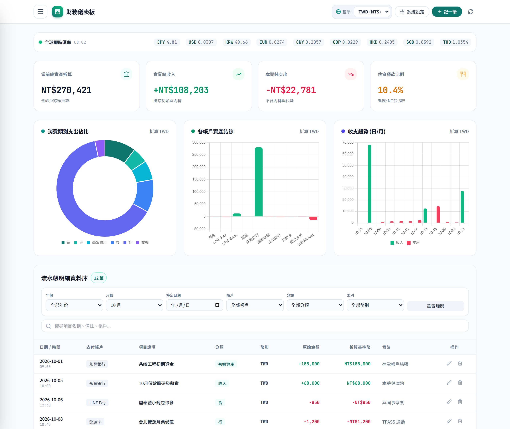
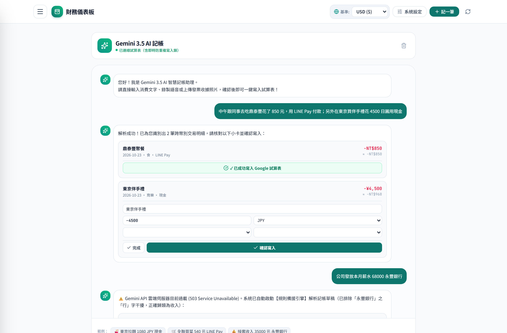
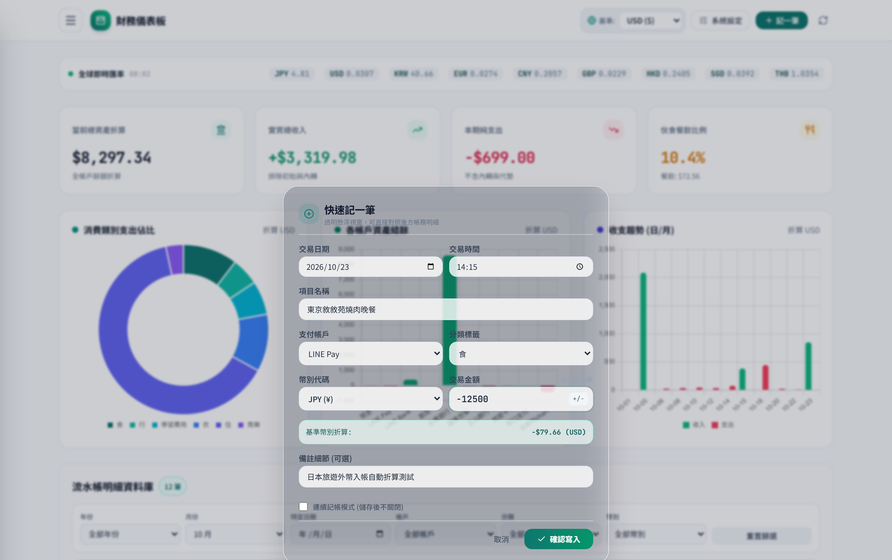
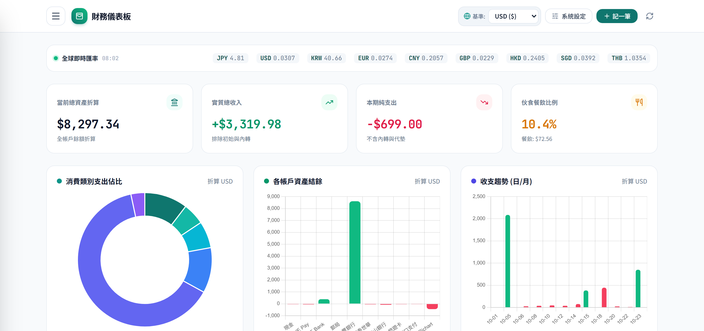
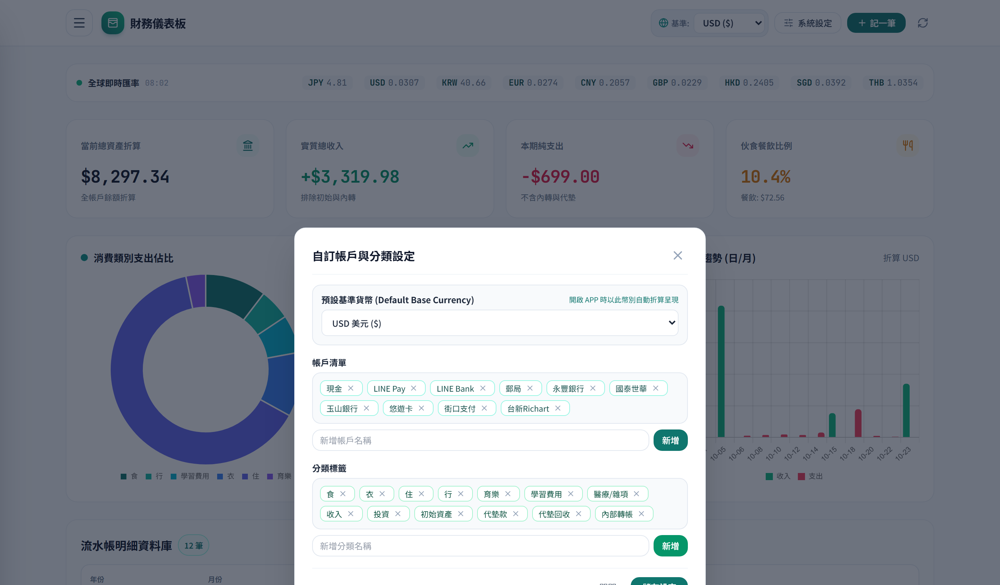
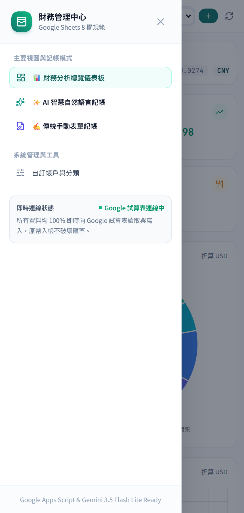
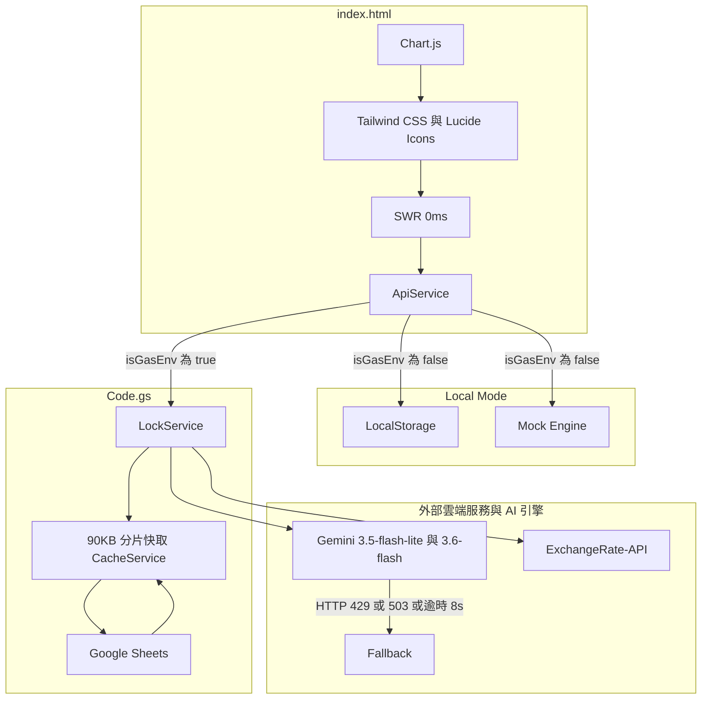
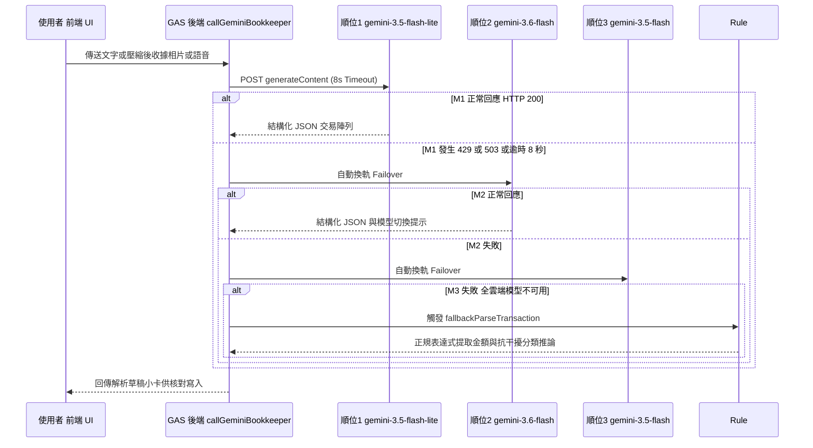

# 📊 GemLedger-26 ── 基於 Google Sheets 與 Gemini 多模態 AI 之無伺服器多幣別智慧記帳系統

[](https://opensource.org/licenses/MIT)
[](https://developers.google.com/apps-script)
[](https://sheets.google.com/)
[](https://ai.google.dev/)
[](https://tailwindcss.com/)
[](https://github.com/google/clasp)

---

## 一、 專案背景與解決痛點

**GemLedger-26** 是一套採用 **無伺服器架構 (Serverless)** 設計的現代化多幣別個人財務管理與智慧記帳系統。傳統記帳軟體在實務使用上普遍存在兩大核心痛點：
1. **手動輸入摩擦力過高**：每筆消費皆須手動點選日期、時間、支付工具、分類與正負金額，繁瑣的操作容易導致使用者半途而廢。
2. **數據孤島與隱私綁架**：個人財務明細被鎖定在第三方商業 App 的私有雲資料庫中，不僅跨國多幣別記帳通常需要付費訂閱，資料匯出與客製化分析亦受到嚴格限制。

為徹底解決上述問題，本專案以使用者完全擁有資料主權的 **Google Sheets（Google 試算表）** 作為雲端關聯式資料庫，結合 **Google Apps Script (GAS)** 作為後端無伺服器 API 閘道，並深度整合 **Google Gemini 3.5 / 3.6 多模態大型語言模型**。使用者只需輸入一句口語文字、上傳發票照片或錄製語音，系統即可自動解析為標準 8 欄位結構化帳務並寫入試算表。


*▲ 圖 1：GemLedger-26 主畫面實機截圖 ── 整合全球即時匯率條、四大財務 KPI 指標、Chart.js 三大視覺化分析圖表與 7 維度複合篩選明細表。*

---

## 二、 系統實機功能展示

以下為本系統五大核心功能模組之實機運行畫面與技術細節拆解：

### 1. Gemini 3.5 多模態對話記帳與微調小卡


*▲ 圖 2-A：AI 多模態自然語言記帳室 ── 同時展示「單句多筆跨幣別拆解」、「寫入前展開微調模式」與「503 離線規則備援引擎」。*

- **單句多筆跨幣別同時解析**：當使用者輸入*「中午跟同事去吃鼎泰豐花了 850 元，用 LINE Pay 付款；另外在東京買伴手禮花 4500 日圓用現金」*，AI 自動拆解為兩張獨立交易確認卡（自動識別 `TWD -850` 與 `JPY -4,500` 並折算基準幣別）。
- **寫入前互動式微調**：點擊卡片上的「微調」按鈕即可直接展開下拉選單修改金額、幣別、帳戶與分類，並具備**防連點重複寫入安全鎖 (`isSubmitting`)**。
- **503 離線規則備援無縫接手**：畫面下方展示了當雲端 API 發生 `503 Service Unavailable` 時，系統自動啟動後端規則引擎解析*「公司發放本月薪水 68000 永豐銀行」*，精準識別為正數收入 `+68,000` 並排除「永豐銀行」中「行」字對交通分類的干擾。

---

### 2. Glassmorphism 毛玻璃懸浮快速記帳視窗


*▲ 圖 2-B：快速記一筆毛玻璃懸浮視窗 ── 選擇 JPY 並輸入 `-12500` 時，下方即時顯示折算為基準幣別之金額預覽。*

- **透視對照設計**：採用 `backdrop-blur-xl` 與半透明白色基底 (`bg-white/92`)，讓使用者在彈窗輸入帳務時，雙眼仍可直接透視對照後方的儀表板圖表與歷史流水帳。
- **即時外幣折算預覽**：當使用者選擇 `JPY (¥)` 並輸入 `-12500` 時，下方即時預覽列會同步依據當日匯率顯示折算後之基準幣別金額（如 `-$79.66 (USD)` 或 `-NT$2,598 (TWD)`），並支援「連續記帳模式」與 `+/-` 正負號一鍵切換。

---

### 3. 11 國貨幣即時折算與多維度動態儀表板


*▲ 圖 2-C：全站基準貨幣動態切換展示 ── 將右上角基準幣別由 `TWD (NT$)` 切換為 `USD ($)` 後，所有 KPI 與圖表座標軸於 0ms 內自動重算（可與圖 1 對照）。*

- **原幣入帳、動態折算**：Google 試算表底層永遠保存原始消費幣別與金額，前端右上角切換基準貨幣（支援 `TWD`, `USD`, `JPY`, `EUR`, `KRW`, `GBP`, `CNY`, `HKD`, `SGD`, `THB`, `AUD`）時，全站 4 大 KPI 卡片、3 張圖表與明細表於 0 毫秒內即時重算。
- **智慧排除內部轉帳與代墊**：計算「實質總收入」與「本期純支出」時，演算法自動剔除 `初始資產`、`內部轉帳` 與 `代墊款`，真實反映當月淨現金流與伙食餐飲佔比（恩格爾係數指標）。

---

### 4. 自訂帳戶/分類與行動端 RWD 體驗

|  |  |
| :---: | :---: |
| *▲ 圖 2-D：自訂帳戶與分類設定視窗（支援預設基準貨幣與雙向同步管理）* | *▲ 圖 2-E：手機端 (430px) 響應式視圖與側邊導航抽屜* |

- **雙向同步與級聯清理**：使用者可在「系統設定」自由新增或移除帳戶（如 `LINE Pay`、`永豐銀行`、`台新Richart`）與分類標籤。
- **手機端資訊降噪**：在手機窄螢幕 (`<= 768px`) 下自動收合次要欄位，並支援 **Page Visibility API 切出 App 自動暫存與喚醒重試**，解決手機切換至 LINE 查看金額再切回瀏覽器時網路請求被系統中斷的問題。

---

## 三、 系統架構與技術棧

本系統採用無須複雜打包工具的單頁應用程式 (SPA) 架構，並透過 Google 官方 `@google/clasp` CLI 工具實現本地 Git 版本控制與雲端自動化部署。



| 系統層級 | 採用技術 / 服務 | 關鍵設計考量與工程效益 |
| :--- | :--- | :--- |
| **前端視圖與互動** | HTML5 + ES6+ JavaScript + Tailwind CSS | 零框架編譯負擔，支援抽屜導航、毛玻璃彈窗與手機背景喚醒恢復。 |
| **首屏加速策略** | SWR (`Stale-While-Revalidate`) | 開啟瞬間先以 `localStorage` 快取 0ms 渲染圖表，背景再以 `Promise.allSettled` 靜默同步雲端。 |
| **環境適配器** | Adapter Pattern ([`ApiService`](./index.html)) | 單一 `isGasEnv` 判斷點，讓同一份程式碼同時支援 GAS 雲端與本地瀏覽器離線執行。 |
| **後端閘道與資料庫** | Google Apps Script + Google Sheets | 完全免費無伺服器架構，利用 `PropertiesService` 隔離 API 金鑰不外洩至前端。 |
| **AI 自然語言與視覺** | Gemini API (`v1beta`) | 強制 `responseMimeType: "application/json"` 與 `temperature: 0.1`，確保數字與分類輸出零幻覺。 |

---

## 四、 四大核心工程突破與演算法解析

### 1. 雙環境同構適配器模式 (Dual-Environment Adapter Pattern)
一般 Google Apps Script 專案因前端寫死 `google.script.run`，導致在本地電腦開發時無法直接用瀏覽器打開測試。本專案於 [`index.html`](./index.html) 實作嚴格的 **Adapter Pattern**：
- 全專案僅在 `ApiService` 內部進行唯一一次環境偵測：`const isGasEnv = typeof google !== 'undefined' && Boolean(google?.script?.run);`。
- `ApiService` 下的所有方法（如 `getSheetData`、`addTransaction`、`callGeminiBookkeeper`、`deleteAccountCascade`）皆實作雙分支並回傳相同簽章的 `Promise`。在本地環境下自動退回 `LocalStorageAdapter` 並注入種子資料，達成 **Zero-Config 離線開發與實機展示**。

### 2. 三層級 AI 容錯級聯與抗干擾規則引擎
為解決雲端 LLM 常見的 `429 Too Many Requests`（每分鐘配額上限）與 `503 Service Unavailable`（模型過載），[`Code.gs`](./Code.gs) 設計了四層防護網：



### 3. 突破 GAS 100KB 硬限制之 90KB 自動分片快取
Google Apps Script 的 `CacheService` 規定單一 Key 的 Value 上限為 **100KB**。當歷史記帳超過數千筆時，直接呼叫 `cache.put()` 會拋出超過大小上限例外。
- **解決方案**：`putLargeCache()` 與 `getLargeCache()` 以 **90KB (`90 * 1024 bytes`)** 為切片單位，自動將大型 JSON 字串分割為 `CACHE_SHEET_DATA_V1_part_0`、`part_1`... 並記錄 `_chunks` 總數，使數萬筆帳務依然能維持 200ms 內的極速讀取。

### 4. 互斥鎖定與參照完整性級聯刪除
- **併發安全 (`LockService`)**：所有寫入與修改操作皆透過 `LockService.getScriptLock().tryLock(10000)` 保護，防止多人同時記帳或連點時發生資料列覆寫 (Race Condition)。
- **級聯清理 (`_executeCascadeDelete`)**：刪除自訂帳戶或分類時，後端在同一個 Lock 交易週期內同步過濾並重寫「系統設定」與「記帳資料」兩張工作表，確保資料庫不殘留孤兒紀錄 (Orphaned Records)。

---

## 五、 資料庫綱要與資安防護設計

### 1. Google Sheets 雙工作表正規化結構
| 工作表名稱 | 欄位順序與格式規範 | 系統用途說明 |
| :--- | :--- | :--- |
| **記帳資料** | `A:日期 (YYYY-MM-DD)`、`B:時間 (HH:mm)`、`C:帳戶`、`D:項目名稱`、`E:分類`、`F:幣別`、`G:金額 (負支出/正收入)`、`H:備註` | 儲存所有歷史流水帳，支援試算表手動編輯自動觸發 `onEdit(e)` 清除快取。 |
| **系統設定** | `A:帳戶清單`（現金、LINE Pay、永豐銀行等）、`B:分類清單`（食、衣、住、行、育樂、收入等） | 動態生成前端下拉選單，並於每次呼叫 Gemini 時動態注入 System Prompt。 |

### 2. 敏感憑證隔離與資安規範
1. **API 金鑰零前端暴露**：`GEMINI_API_KEY` 僅儲存於 GAS 後端的 `PropertiesService.getScriptProperties()`，前端 HTML/JS 原始碼完全不含任何金鑰字串。
2. **雙重版控防護 ([`.gitignore`](./.gitignore) & [`.claspignore`](./.claspignore))**：嚴格排除 `.clasp.json`、`.clasprc.json`、GCP 憑證與私人財務試算表檔案，僅允許程式碼 (`Code.gs`, `index.html`, `appsscript.json`) 與乾淨空白範本同步。

---

## 六、 系統部署方法與開源專案資訊

本專案完整開源於 GitHub，並提供 **「本地零設定離線體驗」**、**「Clasp CLI 工程化自動部署」** 與 **「瀏覽器手動部署」** 三種執行與部署方式：

- 🔗 **GitHub 開源儲存庫**：[https://github.com/jaytsbo/gemledger-26-speach](https://github.com/jaytsbo/gemledger-26-speach)

### 方式一：本地端零設定離線測試 (Local Mock Mode)
受惠於系統內建的 `ApiService` 雙環境適配器，無須綁定 Google 雲端帳號即可於本地直接啟動測試：
```bash
# 1. 複製 GitHub 專案至本地並安裝相依套件
git clone https://github.com/jaytsbo/gemledger-26-speach.git
cd gemledger-26-speach
npm install

# 2. 啟動本地預覽伺服器 (Port 4173)，自動載入 LocalStorage 種子資料
npm run dev
```

### 方式二：使用 Google Clasp CLI 自動化雲端部署 (推薦開發流程)
透過 `@google/clasp` 工具鏈，可在本地 IDE 進行 Git 版本控制並一鍵推送至 Google Apps Script 雲端（透過 [`.claspignore`](./.claspignore) 自動過濾非必要檔案，僅上傳 `Code.gs`、`index.html` 與 `appsscript.json`）：
```bash
# 1. 登入 Google 帳號並綁定 Apps Script 專案 Script ID
npm run login
cp .clasp.json.example .clasp.json   # 填入試算表對應之 scriptId

# 2. 將本地程式碼推送至雲端並發布為 Web App
npm run push
npm run deploy
```

### 方式三：透過 Google 試算表瀏覽器介面手動部署
1. **初始化試算表**：建立全新的 Google 試算表，將專案內的 `記帳本.xlsx` 匯入（或於擴充選單點選「初始化 8 欄位記帳資料工作表」與「初始化系統設定工作表」）。
2. **貼上前後端程式碼**：點選試算表頂部選單 **「擴充功能」 > 「Apps Script」**，將 [`Code.gs`](./Code.gs) 與 [`index.html`](./index.html) 貼入對應檔案中。
3. **設定安全金鑰**：於 Apps Script 左側 **「專案設定 (齒輪)」 > 「指令碼屬性」** 新增 `GEMINI_API_KEY`，或直接透過試算表上方自訂選單點選「🔑 設定/更新 Gemini API Key」。
4. **發布網頁應用程式**：點擊右上角 **「部署」 > 「新增部署作業」**，類型選擇「網頁應用程式 (Web App)」，存取權限設為「僅限我自己」，授權完成後即可取得專屬記帳網址。

---

## 七、 結論與未來展望

**GemLedger-26** 證明了結合 **Serverless 無伺服器架構（GAS + Google Sheets）** 與 **Gemini 3.5 / 3.6**，能以零伺服器維運成本打造出媲美商業級產品的智慧個人財務系統。透過 **SWR 0ms 首屏快取**、**90KB 分片快取**、**雙環境適配器** 與 **四層級 AI 容錯機制**，本專案在工程穩定度、回應速度與使用者體驗上皆達到了高度成熟的水準。

**未來展望與擴充方向**：
1. **訂閱制與固定收支自動排程**：結合 GAS 的 Time-driven Triggers（時間驅動觸發器），於每月固定日期自動寫入房租、串流訂閱或固定薪資。
2. **AI 月度財務健檢報告與異常推播**：利用 Gemini 對當月累積的消費結構進行深度分析，主動標示異常超支類別並提供個人化理財建議。

---

## 📄 開源授權 (License)

本專案基於 [MIT License](https://opensource.org/licenses/MIT) 授權開源。
